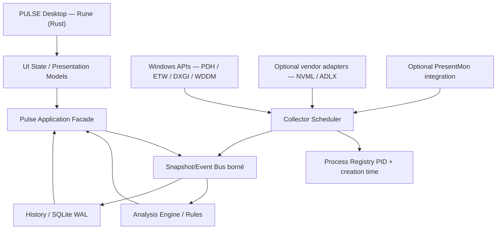

# PULSE — Dossier complet : ADR + Design System + Product Spec + Roadmap

> Version 1.0 — 22 novembre 2026. Référence UI : Rust + Rune (anomalyco/rune).


---

<!-- Fichier source : README.md -->

# PULSE — Architecture, cadrage et Design System

Dossier de spécification pour **PULSE**, gestionnaire des tâches et centre de diagnostic système **Windows 11 natif en Rust + Rune**.

> **Décision non négociable :** UI avec [anomalyco/rune](https://github.com/anomalyco/rune). Tauri/Svelte/React ne font pas partie de l'architecture retenue.

## Documents

- [`docs/ADR-0001-architecture.md`](docs/ADR-0001-architecture.md) — décisions techniques, collecteurs, diagnostics, architecture et risques.
- [`docs/DESIGN-SYSTEM.md`](docs/DESIGN-SYSTEM.md) — identité visuelle issue des dernières maquettes, tokens, composants Rune, écrans et interactions.
- [`docs/PRODUCT-SPEC.md`](docs/PRODUCT-SPEC.md) — parcours utilisateurs, fonctionnalités P0–P3, comportements métier et définition de terminé.
- [`docs/IMPLEMENTATION-PLAN.md`](docs/IMPLEMENTATION-PLAN.md) — milestones, spikes, CI et tickets prioritaires.
- [`design/tokens.json`](design/tokens.json) — tokens d'intention design à adapter au thème Rune.
- [`assets/pulse-reference-4-ecrans.png`](assets/pulse-reference-4-ecrans.png) — référence visuelle : Dashboard, GPU, Memory Leak Hunter, Diagnostics gaming.
- [`assets/pulse-reference-processus.png`](assets/pulse-reference-processus.png) — écran détail processus de référence.

## Brief de démarrage pour un agent de développement

1. Lire **tous les fichiers** du dossier, commencer par l'ADR et le Design System.
2. Lire `examples/hello`, `crates/rune/README.md` et `crates/rune-kit/README.md` de `anomalyco/rune`.
3. Épingler Rune à une **révision Git précise** de `dev` ; commiter le lockfile. Ne pas mettre de faux SHA.
4. Commencer par le **Spike Rune**, avec les 4 écrans via fixtures et captures headless. Ne pas commencer par ETW/NVML ou l'IA.
5. Conserver un design **sobre bleu nuit/blanc/bleu**, fidèle aux maquettes. Ne pas dériver vers une UI néon/glassmorphism, ni un design thématique.
6. Construire le monitoring Windows en modules Rust indépendants, avec métriques sourcées et états d'indisponibilité.
7. Ne jamais prétendre confirmer une fuite mémoire à partir d'une simple hausse de RAM ; ne jamais afficher des métriques inventées.

## Statut

Il s'agit d'un **dossier de conception prêt à servir de base au dépôt**. Ce n'est pas un programme fonctionnel ni une preuve que les capacités système avancées sont déjà implémentées. Les seuils et budgets sont à valider par instrumentation et tests.


---

<!-- Fichier source : docs/ADR-0001-architecture.md -->

# ADR-0001 — Architecture de PULSE

| Champ | Valeur |
|---|---|
| Produit | **PULSE** — System Monitor & Diagnostics (nom de travail) |
| Statut | **Accepté pour le cadrage / à valider par prototypes techniques** |
| Version du dossier | 1.0 |
| Date | 22 novembre 2026 |
| Cible initiale | Windows 11 x64 ; Windows 10 seulement après validation explicite |
| Langue | Rust |
| Framework UI obligatoire | **[Rune — anomalyco/rune](https://github.com/anomalyco/rune)** |
| Référence visuelle | `assets/pulse-reference-4-ecrans.png` |

## 1. Contexte et problème

Les gestionnaires des tâches traditionnels fournissent essentiellement une photographie instantanée. Ils répondent mal à trois questions : **que s'est-il passé avant un ralentissement ?**, **quel processus est responsable ?** et **une hausse de mémoire/VRAM est-elle réellement suspecte ?**. Les outils spécialisés existent mais fragmentent le diagnostic entre plusieurs applications.

PULSE est un gestionnaire des tâches et un outil de diagnostic système **local, natif, sobre, rapide et open source**, avec des vues de processus, CPU, GPU/VRAM, RAM, disques, réseau et températures (quand disponibles), un enregistrement historique, et un moteur de détection d'anomalies explicable. Il ne s'agit ni d'un nettoyeur de PC ni d'un outil qui promet de « réparer » la machine automatiquement.

### 1.1 Objectifs

1. Afficher les métriques essentielles avec leur **source, unité, horodatage et niveau de disponibilité**.
2. Explorer, filtrer et comparer les processus en temps réel.
3. Surveiller GPU, VRAM, moteurs GPU et paramètres thermiques selon les capacités réelles du matériel.
4. Revenir sur des incidents passés via **Time Travel** et identifier des contributions observables.
5. Détecter des **suspicions** de fuites mémoire et fournir des éléments de diagnostic, pas un verdict inventé.
6. Rester utilisable en tant qu'utilisateur standard pour les opérations courantes.
7. Proposer une interface native en Rust, entièrement construite avec **Rune**, fidèle aux maquettes fournies.
8. Publier un dépôt public maintenable, testé, documenté, compatible avec des contributions.

### 1.2 Hors périmètre initial

- Antivirus, détection de malware et classification de processus « dangereux ».
- Nettoyage automatique de RAM, suppression de caches, overclocking, undervolting ou modification de BIOS.
- Débogueur mémoire avec identification exacte de l'objet non libéré dans n'importe quel processus fermé.
- Interception de tout le trafic réseau déchiffré, ou surveillance furtive.
- Service cloud, connexion obligatoire, collecte distante ou télémétrie sortante par défaut.
- Parité Linux/macOS dans la première version ; le cœur doit néanmoins être conçu pour permettre des plateformes futures.
- UI React, Svelte, Electron, WebView ou Tauri : **non retenus pour cette architecture**.

## 2. Décisions retenues

### ADR-001-A — UI native Rune, obligatoire

- Le front-end est **100 % Rust + Rune** : layout, typographie, états, tableaux, interactions et graphiques.
- Rune est le **framework graphique imposé**. Ne pas remplacer silencieusement Rune par Tauri, Svelte, React, egui, Slint ou WinUI.
- Rune est actuellement **en préversion**. Utiliser une dépendance Git **épinglée à un SHA précis du dépôt `dev`**, documentée dans `Cargo.lock` et `docs/DEPENDENCIES.md`. Ne jamais dépendre d'une branche mouvante en production.
- Commencer l'intégration à partir de `examples/hello`, `crates/rune/README.md` et `crates/rune-kit/README.md` du dépôt source.
- Les composants du design system doivent être des **composants Rune réutilisables** ; les tokens doivent être centralisés et adaptés au système de thèmes Rune.
- Utiliser le rendu vectoriel natif Rune (formes, segments, polylignes, texte) pour les graphiques. **Aucune dépendance de charting Web/Canvas HTML**.
- Exploiter le mode **headless Rune** (captures PNG, arbre d'éléments, input scripté) pour les tests visuels et interactions.
- Prévoir un **spike de compatibilité** avant le développement fonctionnel (voir §12) ; en cas d'échec, ouvrir un nouvel ADR au lieu de substituer une autre UI sans accord.

**Pourquoi :** une seule pile Rust, contrôle du rendu, intégration native, architecture autonome et forte valeur technique pour GitHub.

**Conséquences :** maturité de Rune à surveiller ; davantage de composants de données et de graphiques à construire, effort d'intégration Windows supérieur à une UI web.

### ADR-001-B — Windows-first et cœur découplé

- Cible de build prioritaire : `x86_64-pc-windows-msvc` avec outils de compilation C++ Visual Studio requis par la chaîne Windows.
- Adaptateurs Windows encapsulés dans `pulse-platform-windows` ; la logique métier ne dépend pas directement des API Windows.
- Les collecteurs sont facultatifs et peuvent déclarer `Available`, `Unsupported`, `PermissionRequired`, `TemporarilyUnavailable`, `Error`.
- Une donnée indisponible doit afficher « Non disponible » ou une explication, **jamais une valeur fictive ni 0 par défaut**.

### ADR-001-C — Collecte hybride, graduée

- **Polling** à fréquence mesurée pour les valeurs courantes ; **ETW / traceurs spécialisés** seulement quand nécessaire et autorisé.
- Les collecteurs fonctionnent sur des workers dédiés et publient des snapshots immuables ; aucun appel lent à l'OS depuis le rendu Rune.
- La fréquence varie selon la visibilité de l'écran, la capacité matérielle et le mode d'enregistrement.
- Les API natives Windows sont préférées aux parsers de sorties de commandes externes.

### ADR-001-D — Stockage local, résumé avant détail

- Ring buffer borné en mémoire pour le temps réel.
- Base **SQLite en mode WAL** pour événements, sessions, métadonnées et agrégats persistants.
- Les échantillons haute fréquence sont stockés en segments/chunks compacts si nécessaire ; l'application doit mesurer leur coût réel avant de figer le format.
- Rétention paramétrable ; la collecte persistante longue durée est **désactivable**, avec limite explicite de stockage.
- Aucun chemin complet de fichier, argument de ligne de commande ou adresse réseau privée n'est inclus par défaut dans un export partageable sans consentement spécifique.

### ADR-001-E — Diagnostics honnêtes et explicables

- Les alertes doivent être **déterministes, rejouables et explicables** avec mesures d'appui.
- Une « fuite mémoire suspectée » est un signal statistique. Une courbe ascendante ne prouve pas une fuite.
- Un diagnostic doit distinguer **observation**, **hypothèse**, **niveau de confiance calibré** et **action recommandée**.
- Pas de pourcentage de « confiance » inventé : utiliser `faible / modérée / élevée` tant qu'une évaluation sur jeux de tests n'établit pas une calibration.
- Les contributions par processus à une charge GPU ou CPU sont calculées en respectant les sémantiques de leurs compteurs ; ne pas supposer que tous les pourcentages GPU sont additionnables.

### ADR-001-F — Sécurité et permissions minimales

- Processus UI non élevé par défaut.
- Les opérations protégées (terminaison d'un processus privilégié, traces ETW étendues, etc.) demandent une élévation ciblée et explicite ; aucune élévation permanente de toute l'UI.
- Liste d'actions sensibles avec confirmation et information du risque.
- Pas d'auto-kill, de suspension ou de modification de priorité sur la seule base d'un diagnostic.
- Traitement local ; aucun upload caché et aucune collecte de secrets.

## 3. Vue d'architecture



Flux : API OS → collecteur → validation/normalisation → bus → ring buffer/historique/moteur d'analyse → modèles de présentation → Rune. Les commandes utilisateur passent par une façade distincte et un gestionnaire d'autorisations.

### 3.1 Modules Rust proposés

```text
pulse/
├── Cargo.toml
├── Cargo.lock
├── crates/
│   ├── pulse-app/                # binaire desktop, initialisation Rune, navigation
│   ├── pulse-ui/                 # écrans Rune + composants + tableaux + charting
│   ├── pulse-design/             # tokens, thème, typographie, primitives Rune
│   ├── pulse-domain/             # types, unités, identités, contrats publics
│   ├── pulse-runtime/            # workers, scheduler, snapshot bus, état
│   ├── pulse-platform-windows/   # Windows API, permissions, ETW, PDH
│   ├── pulse-process/            # registre de processus et CPU/RAM
│   ├── pulse-memory/             # courbes et investigation de mémoire
│   ├── pulse-gpu/                # WDDM + adapters GPU vendor
│   ├── pulse-disk/               # I/O et disques
│   ├── pulse-network/            # connexions et compteurs réseau
│   ├── pulse-sensors/            # capacités thermiques facultatives
│   ├── pulse-history/            # ring buffer, SQLite, rétention, export
│   ├── pulse-insights/           # heuristiques, alertes, explications
│   ├── pulse-gaming/             # sessions de jeu, PresentMon facultatif
│   └── pulse-testkit/            # fixtures, replays, fake collectors
├── docs/
│   ├── ADR-0001-architecture.md
│   ├── DESIGN-SYSTEM.md
│   ├── PRODUCT-SPEC.md
│   └── IMPLEMENTATION-PLAN.md
├── design/
│   └── tokens.json
├── assets/
│   ├── pulse-reference-4-ecrans.png
│   └── pulse-reference-processus.png
└── .github/workflows/
```

### 3.2 Contrats de domaine

Chaque mesure doit porter son unité, l'identité du sujet, la date et l'origine. Exemple de **contrat conceptuel** (à adapter aux APIs réellement exposées) :

```rust
#[derive(Clone, Copy, Debug, Hash, PartialEq, Eq)]
pub struct ProcessKey {
    pub pid: u32,
    pub created_at_ticks: u64, // évite la confusion lors de la réutilisation d'un PID
}

pub enum Availability<T> {
    Available(T),
    Unsupported,
    PermissionRequired,
    TemporarilyUnavailable,
    Error(String),
}

pub struct Sample<T> {
    pub observed_at_utc_ms: i64,
    pub monotonic_tick_ns: u64,
    pub source: &'static str,
    pub value: Availability<T>,
}
```

- Horloge monotone pour durées/débits, UTC pour journalisation ; traiter les sauts d'heure système.
- Pourcentages, octets, octets/s, watts, degrés C, MHz et FPS sont des **unités distinctes** ; ne jamais sommer des métriques incompatibles.
- Les compteurs cumulatifs sont transformés en **débits différentiels** en traitant réinitialisations, erreurs et changements d'identité.
- Les modèles de présentation sont des projections légères des snapshots, pas des appels directs au système.

## 4. Stratégie de collecte par famille

| Domaine | Données et provenance cible | Limites à respecter | Priorité |
|---|---|---|---|
| CPU | Charge système/processus, cœurs logiques, temps CPU, threads, priorité via API Windows | CPU process à normaliser explicitement selon cœurs/temps | P0 |
| RAM | Working set, private bytes, commit, handles, page faults via Windows | Working set ≠ allocations possédées ; pas de preuve de leak | P0 |
| Processus | Nom, PID, creation time, parent, état, exécutable si autorisé | PID réutilisable ; accès partiel aux processus protégés | P0 |
| Disques | Débits, latences disponibles, I/O par processus, volumes | SMART/NVMe non garantis par toutes les machines | P1 |
| Réseau | Interfaces, débits globaux, connexions associées aux PID | Attribution fine de débits par processus nécessite instrumentation adaptée | P1 |
| GPU | WDDM / compteurs graphiques Windows, moteurs et VRAM par processus selon disponibilité | Une valeur NVIDIA NVML ne remplace pas la vérité WDDM par processus | P1 |
| Capteurs | NVML NVIDIA ; AMD ADLX si faisable ; capteurs OS / vendors | Température, hotspot, watts et ventilateurs **facultatifs** | P1–P2 |
| FPS / gaming | PresentMon ou API adaptée sur demande | Capture et privilèges variables ; frametimes indisponibles sans intégration | P2 |
| Traces | ETW et fournisseurs pertinents pour investigation ciblée | Volume/charge ; droits potentiellement élevés | P2 |

### 4.1 Cadence indicative (à benchmarker)

- Processus/CPU/RAM : **1 s** en premier plan ; **2–5 s** en arrière-plan suivant configuration.
- GPU et capteurs : **1–2 s** quand la vue GPU est active, ralentissement si vue masquée.
- Éléments coûteux (connexions détaillées, inventaire matériel, SMART) : **5–30 s**, ou à la demande.
- Vue graphique : fréquence d'affichage indépendante de la collecte ; **ne jamais créer une mesure fictive à chaque frame**.
- ETW : **session explicite**, règles de buffer et interruption contrôlée.
- Sampling configurable : « Éco », « Standard » et « Haute précision » avec coûts mesurés.

## 5. Identification des processus et actions

- Clé de processus : `(PID, heure réelle de création issue du système)` ; le nom seul ne suffit pas.
- Un arbre de processus se reconstruit sur parent + identifiant de génération et gère les parents disparus.
- Les applis regroupées (navigateurs) ne doivent pas masquer les sous-processus.
- Colonnes : nom, PID, CPU, RAM résidente, mémoire privée, GPU, VRAM, disque, réseau, temps d'exécution, état ; colonnes non disponibles masquées ou `—` avec tooltip.
- Recherche par nom/PID, tri stable, filtres (apps, arrière-plan, services, GPU actif, anomalies), favoris et détail du processus.
- Actions : terminer (avec confirmation), priorité, affinité, ouvrir le dossier, copier PID/chemin, suspendre si permission/implémentation disponible ; ne jamais afficher un contrôle inopérant.
- Protéger les processus critiques Windows, vérifier les permissions et expliquer les échecs.

## 6. Détecteur de fuites mémoire

### 6.1 Principe

Surveillance passive d'abord ; profilage avancé ensuite. Un algorithme ne doit **jamais conclure à une fuite certaine par simple croissance de RAM**. Les métriques à comparer sont notamment private bytes, commit, working set, handles, threads, page faults et variations de charge.

### 6.2 Algorithme v1 (suspicions)

1. Collecter les mesures d'un **même ProcessKey** sur une fenêtre suffisamment longue (par exemple au moins 30 min et ≥ 20 points valides).
2. Calculer une pente robuste de mémoire privée (par exemple Theil–Sen) et le cumul de croissance absolue.
3. Détecter les paliers, retours à la ligne de base, plateaux et phases connues de chargement.
4. Normaliser les observations avec durée d'exécution et activité du processus ; signaler la **limite de l'analyse** si cette contextualisation manque.
5. Optionnellement, rechercher des tendances corrélées dans les handles, threads, commit et allocations si traçables.
6. Émettre un événement explicable avec preuves, période, métriques et causes alternatives possibles.
7. Permettre d'enregistrer une session et de comparer avec une autre exécution comparable.

**Règle initiale de test, non calibrée :** suspecter une croissance soutenue de `private bytes` d'au moins 256 Mio et ≥ 64 Mio/h sur 30 minutes, sans retour substantiel au niveau de base ; ne pas traiter ces seuils comme des valeurs universelles ou une preuve scientifique. Tous les seuils seront configurables et évalués avec des fixtures.

### 6.3 États et vocabulaire

- `InsufficientData` : surveillance trop courte.
- `Stable` : pas de tendance préoccupante observée.
- `GrowthObserved` : hausse constatée, sans conclusion.
- `PotentialLeak` : suspicion étayée, nécessite investigation.
- `InvestigationRequired` : instrumentation supplémentaire nécessaire.

À afficher : « Croissance anormale observée » ou « Fuite potentielle », jamais « fuite confirmée » sans trace probante. Un pourcentage de confiance n'est autorisé qu'après validation statistique documentée.

### 6.4 Validation

Fixtures de validation : vrai leak dans programme de test Rust/C++, cache borné avec plateau, montée de charge légitime, allocation puis libération, oscillation, processus tué/redémarré avec PID réutilisé, pertes de mesures. Mesurer faux positifs, faux négatifs et temps de détection.

## 7. GPU et Gaming

### 7.1 GPU Inspector

- Sélection multi-GPU (iGPU, dGPU). Chaque métrique affiche son adaptateur exact.
- Utilisation globale, moteurs `3D`, `Compute`, `Copy`, `Video`, utilisation des moteurs selon API, VRAM dédiée et partagée, fréquence et température/puissance si disponibles.
- Processus utilisant GPU/VRAM et historique ; distinguer VRAM allouée, utilisée, dédiée, partagée et mémoire GPU rapportée par les API.
- Adaptateur NVIDIA NVML chargé **facultativement** ; ne pas rendre Rune ou l'application dépendante du runtime NVIDIA.
- AMD/Intel : capacité déclarée au cas par cas ; aucun chiffre GPU inventé pour combler une lacune.

### 7.2 Gaming Diagnostics (P2)

- Démarrer/arrêter une session ciblée sur un processus de jeu.
- Lorsque disponible : FPS moyen, percentiles calculés correctement (1% lows selon définition documentée), frametimes, GPU Busy, tendances CPU/GPU/VRAM, events du système.
- Marquer les événements de process spawn/exit et pics de ressources ; **corrélation temporelle ≠ causalité certaine**.
- Export d'un rapport contenant configuration, métriques agrégées et note sur métriques indisponibles.
- Présence d'anti-cheats : ne pas injecter, contourner ou modifier les protections ; collecter seulement ce qui est permis.

## 8. Time Travel et persistance

### 8.1 Modèle

```text
Session(id, started_at, ended_at, device_snapshot, sampling_profile)
ProcessIdentity(session_id, process_key, name, parent_key, executable_label)
MetricSample(session_id, subject_key, metric_key, captured_at, numeric_value, availability)
Event(id, session_id, captured_at, kind, severity, subject_key, evidence_json)
Alert(id, event_id, state, acknowledged_at, rule_version)
```

Tables physiques optimisées à partir de ce modèle logique ; les séries brutes à forte fréquence peuvent être placées dans des chunks. Index sur `(session_id, subject_key, metric_key, captured_at)` et sur les événements par temps/sévérité.

### 8.2 Rétention suggérée

- **RAM** : 15 min de données 1 s en ring buffer ; borne mémoire stricte.
- **Historique local** : 24 h de données agrégées à la minute par défaut, configurable ; rétention plus longue uniquement sur activation de l'enregistrement.
- **Enregistrement manuel** : session détaillée, limite de taille et durée, prévision du volume, arrêt simple et export contrôlé.
- Politique de purge déterministe, protection contre rupture d'alimentation (SQLite WAL), migrations versionnées, `VACUUM` planifié seulement si utile.
- Fuseaux horaires : stockage UTC, présentation locale. Historique doit gérer veille, reprise et sauts de temps.

### 8.3 Rejouer un incident

Choisir session → placer curseur temporel → afficher métriques système synchronisées → classer les processus contributeurs à cet instant → ouvrir une fiche d'incident → exporter données et méthodologie. Ne jamais conserver un processus disparu comme « en cours ».

## 9. Sécurité, confidentialité et accessibilité

- **Local-first** : aucune communication réseau requise pour les fonctions principales.
- Opt-in explicite pour vérifications de mises à jour et diagnostics partagés ; politique transparente.
- Journaux techniques sans arguments secrets ; éviter d'enregistrer les lignes de commande complètes.
- Export partageable avec **redaction** par défaut : utilisateur Windows, nom de machine, chemins, domaines privés, IP locales et identifiants.
- Données persistantes sous répertoire utilisateur (emplacement exact défini via API Windows), aucune écriture dans des répertoires système.
- Aucun service administrateur persistant sans nouveau besoin validé et ADR dédié.
- Interfaces clavier et lecteur d'écran avec les rôles, labels et focus de Rune/AccessKit ; contrastes AA visés ; option réduction des animations.
- Confirmation avant toute action destructive, avec nom du processus, PID et effet attendu.

## 10. Performance et robustesse

**Budgets de conception à confirmer par benchmark**, sur une machine représentative et un scénario de 200–500 processus :

| Indicateur | Cible initiale | Méthode de preuve |
|---|---|---|
| Fluidité de l'UI | Animations à 60 Hz lorsque visibles ; tables sans saccades | Captures de frame time, profils |
| CPU en idle avec monitoring standard | Cible **< 2 %** d'un cœur logique sur machine de référence | Benchmark continu 30 min |
| RAM de l'application | Cible **< 200 Mio** sans longue session | Mesure private bytes + working set |
| Latence d'un clic de sélection | P95 **< 100 ms** hors appel OS asynchrone | Tests d'interactions |
| Résistance aux erreurs | Collecteur défaillant isolé, UI toujours utilisable | Injection d'erreur |
| Time Travel | Navigation d'une session de 24 h sans blocage perceptible | Fixture volumineuse |
| Stockage | Plafond configurable, purge vérifiable | Tests de rétention |

Tous les budgets sont **objectifs**, pas des performances annoncées avant mesures. Si Rune ou un adaptateur consomme davantage, documenter le cas avant d'ajuster le budget.

Garde-fous : file d'événements bornée, coalescence des snapshots, backpressure, rafraîchissement différentiel de tableaux, virtualisation des lignes, réduction du sampling fenêtre réduite et arrêt propre des workers.

## 11. Alternatives étudiées

| Option | Décision | Motif |
|---|---|---|
| **Rune** | **Retenu et imposé** | Rust natif, renderer GPU, contrôle du design, headless/testabilité |
| Tauri + Svelte | Rejeté dans ce cadrage | Exigerait un front Web distinct, contraire au choix Rune |
| Electron | Rejeté | Charge et pile distincte non nécessaires |
| egui / Slint / WinUI | Alternatives connues, **non retenues** | Aucune substitution sans nouvel ADR |
| Instrumentation ETW permanente | Rejetée | Coût, droits, volume et complexité |
| LLM pour toutes les alertes | Rejeté | Non déterministe ; règles statistiques expliquées préférables |
| Cloud par défaut | Rejeté | Application système locale et respect de la vie privée |

## 12. Spike Rune indispensable (gate de démarrage)

Avant d'industrialiser, construire un exécutable Rune qui :

1. Démarre sur Windows 11 x64, avec une révision Git Rune **épinglée** et un `Cargo.lock` commité.
2. Affiche fidèlement la sidebar, les tabs, les KPI, une table de **500 lignes virtualisées**, un graphique vectoriel 3 séries et un panneau d'alerte.
3. Reçoit un flux simulé à 1 Hz **sans bloquer l'UI**.
4. Gère clavier, recherche, défilement, focus visible, modification de fenêtre et mise à l'échelle 100 % / 125 % / 150 %.
5. Produit au moins 4 captures PNG reproductibles en **headless** et permet un test d'interaction scripté.
6. Offre une première mesure CPU/RAM/UI frame time et valide que le rendu graphique est techniquement faisable.

**Gate :** si l'une de ces exigences échoue, identifier la limitation, créer une issue, adapter la conception ou proposer un ADR de réévaluation ; **ne pas introduire une autre UI par défaut**.

## 13. Tests et qualité

- Unitaires : conversions d'unités, dérivation des débits, signatures des processus, règles d'alerte, rétention.
- Intégration : adaptateurs Windows sur machines réelles ou runners dédiés ; doubles/fakes quand CI ne peut pas observer le matériel.
- Stress : 500+ processus, 24 h de série simulée, pertes de mesures, GPU absent, GPU multiple, veille/reprise, changement d'échelle DPI.
- UX : test de tri stable, navigation clavier, erreurs de permission, terminaison confirmée, lancement d'une session.
- Screenshot regression : headless Rune, captures de référence, comparaison avec tolérance documentée, validation manuelle des différences attendues.
- CI : `cargo fmt --check`, `cargo clippy -- -D warnings`, `cargo test`, build Windows MSVC, audit dépendances/licences, paquet de préversion signé si possible.
- Releases : versionnage sémantique, changelog, MSI/portable après validation de packaging, hash SHA-256 et provenance des binaires.

## 14. Risques et arbitrages

| Risque | Impact | Mesure |
|---|---|---|
| Rune préversion, APIs mouvantes | Fort | Révision Git pin, spike, tests headless, dépendances contrôlées |
| Métriques GPU inégales selon pilote | Fort | Capability matrix, états `Unavailable`, tests multi-adaptateurs |
| Faux positifs de fuite mémoire | Fort | Terminologie prudente, algorithme rejouable, fixtures, explication |
| Overhead de monitoring | Fort | Sampling adaptatif, profils, budgets et auto-profiling |
| Instrumentation ETW sensible | Moyen/fort | Opt-in, sessions courtes, limites, élévation ciblée |
| Exposition d'informations privées | Fort | Redaction par défaut, local-first, modèle de permissions |
| Graphiques/tableaux complexes en Rune | Moyen/fort | Composants dédiés et spike avant investissement |
| Scope excessif | Fort | Priorités P0→P3 et critères de sortie indépendants |

## 15. Conditions d'acceptation de cet ADR

- UI réellement écrite en **Rune** (pas d'interface HTML cachée).
- Cœur et collecteurs Rust découplés ; UI ne collecte pas directement les métriques.
- Source de chaque métrique affichable dans la fiche technique.
- Identité des processus robuste à la réutilisation des PID.
- Absence de métrique affichée comme 0 en cas d'API non disponible.
- Aucune alerte de leak « confirmée » fondée seulement sur la RAM croissante.
- Pas d'accès réseau implicite ni de droits admin permanents.
- Historique borné et relecture reproductible.
- Design system et tests d'écrans respectés.

## 16. Questions ouvertes, non bloquantes pour le prototype

- Nom final et conflit éventuel de marque « PULSE » (vérification avant publication).
- Niveau de support Windows 10, ARM64 et multi-GPU au lancement.
- Licence du projet (MIT / Apache-2.0 sont des candidats, à choisir par le mainteneur).
- Packaging MSI ou ZIP portable, stratégie de signature et mises à jour.
- Politique de support des API NVIDIA/AMD/Intel selon pilotes et OS.
- Adoption d'un processus de release plus stable quand Rune publiera des versions.

## 17. Références vérifiées

- Rune — dépôt officiel : https://github.com/anomalyco/rune
- Rune — guide du crate : https://github.com/anomalyco/rune/blob/dev/crates/rune/README.md
- Rune Kit — composants : https://github.com/anomalyco/rune/blob/dev/crates/rune-kit/README.md
- Windows Rust bindings : https://github.com/microsoft/windows-rs
- Windows Performance Toolkit / ETW : https://learn.microsoft.com/windows-hardware/test/wpt/
- NVIDIA NVML : https://developer.nvidia.com/management-library-nvml
- AMD ADLX : https://gpuopen.com/adlx/
- PresentMon : https://github.com/GameTechDev/PresentMon

*Les APIs exactes et restrictions par version OS/pilote seront confirmées dans les spikes. Les liens ci-dessus sont des points d'entrée techniques, non une garantie de disponibilité de chaque mesure.*


---

<!-- Fichier source : docs/DESIGN-SYSTEM.md -->

# PULSE Design System — « Precision Desktop »

**Statut :** base validée pour le prototype. **Version :** 1.0 — 22/11/2026. **Framework :** Rune (`anomalyco/rune`) exclusivement.

## 1. Référence et direction visuelle

Les références **à suivre** sont les quatre dernières maquettes présentées ensemble : `assets/pulse-reference-4-ecrans.png` (Dashboard, GPU, Détection de fuite mémoire, Diagnostics gaming) et la vue processus `assets/pulse-reference-processus.png`.

La maquette constitue une **intention graphique**, non une source de données fiables. Les textes/valeurs illustratifs ne doivent pas être codés en dur en production.

### Principes non négociables

1. **Professionnel, lisible, crédible** : un logiciel Windows pour des utilisateurs exigeants, pas une landing page SaaS.
2. **Interface claire** : fond blanc cassé, cartes blanches, contours gris subtils ; navigation bleu nuit.
3. **Accent bleu** pour les actions et l'état sélectionné ; l'orange est utilisé pour les alertes et éventuellement le logo, pas pour toutes les cartes.
4. **Forte densité d'information maîtrisée** : tableaux réellement utiles, graphiques à axes et unités, sans décoration superflue.
5. **Hiérarchie visuelle** : chiffres importants, intitulés sobres, métadonnées secondaires, état de disponibilité visible.
6. **Visualisation fonctionnelle** : couleurs de séries constantes, hover/selection, historique synchronisé.
7. **Pas d'esthétique « IA générative »** : pas de néon, glassmorphism omniprésent, halos violets, grosses ombres, mascotte, paysage, illustration japonaise, gradients décoratifs ou pictogrammes 3D.
8. **Rune uniquement** : chaque composant doit être rendu nativement en Rust ; ne pas reproduire les mockups avec HTML/CSS/Tauri.

## 2. Tokens de couleur

Ces codes sont une **spécification de design à implémenter**, pas une extraction colorimétrique au pixel des maquettes. Le fichier source est `design/tokens.json`.

| Token | Hex | Usage |
|---|---|---|
| `color.shell.sidebar` | `#17283C` | Navigation latérale |
| `color.shell.sidebarHover` | `#223A55` | Survol de navigation |
| `color.shell.sidebarActive` | `#2469BD` | Élément de navigation actif |
| `color.shell.canvas` | `#F5F7FA` | Fond de contenu |
| `color.surface.primary` | `#FFFFFF` | Cartes, tableau, panels |
| `color.surface.secondary` | `#F8FAFC` | En-têtes, filtres, zones secondaires |
| `color.border.default` | `#DDE4EC` | Séparateurs |
| `color.border.strong` | `#C8D2DF` | Champs actifs/inactifs |
| `color.text.primary` | `#172B42` | Texte principal |
| `color.text.secondary` | `#617286` | Sous-titres, unités |
| `color.text.inverse` | `#F8FAFC` | Texte sur sidebar |
| `color.brand.primary` | `#2469BD` | CTA, sélection, focus |
| `color.brand.logo` | `#F28A36` | Identité PULSE discrète |
| `color.state.success` | `#219568` | Système OK, états sains |
| `color.state.warning` | `#D8871B` | Avertissement, suspicion |
| `color.state.danger` | `#D84C4C` | Critique / action destructive |
| `color.state.info` | `#2E89C7` | Information |
| `color.chart.cpu` | `#2474D8` | CPU |
| `color.chart.memory` | `#8A65CF` | RAM |
| `color.chart.gpu` | `#239764` | GPU |
| `color.chart.vram` | `#26A6AA` | VRAM |
| `color.chart.disk` | `#E58B31` | Disque |
| `color.chart.network` | `#3E9CC7` | Réseau |

**Règle :** l'orange `warning` ne doit pas devenir rouge `danger` si le système n'a observé qu'une suspicion. Les couleurs des séries ne changent jamais entre écrans ; elles sont renforcées par des labels, symboles et légendes (pas uniquement par couleur).

## 3. Typographie

- Police UI : **Segoe UI Variable** sur Windows 11, repli **Segoe UI** et police système. Aucun téléchargement de police obligatoire.
- Chiffres et informations techniques : tabular figures / chiffres à largeur constante lorsque le moteur de texte le permet ; repli **Cascadia Mono / Consolas** pour PID, hex, unités techniques.
- Référence d'échelle : titre de page 24 px semibold ; titre section 16 px semibold ; carte 13–14 px semibold ; valeur KPI 26–30 px bold ; texte courant 13 px ; secondaire 11–12 px ; cellule tableau 12–13 px.
- Hauteur de ligne : ~1,35–1,45 pour paragraphes ; densité plus serrée pour labels de données.
- Les abréviations système sont légendées au premier usage (VRAM, Working Set, Private Bytes).
- Utiliser des unités en français : `Go`, `Mo`, `Mo/s`, `°C`, `W`, `MHz`, `FPS`; les valeurs conservées en interne sont en octets/secondes.

## 4. Espacement et géométrie

| Élément | Valeur cible |
|---|---|
| Base spacing | 4 px |
| Gaps majeurs | 16 px |
| Gaps internes | 8 ou 12 px |
| Padding carte | 16 px |
| Sidebar | 216–224 px |
| Topbar | 56 px |
| Hauteur ligne de tableau | 36–40 px |
| KPI simple | 112–136 px |
| Rayon carte | 10 px |
| Rayon contrôle | 7 px |
| Rayon badge | 6 px |
| Largeur bordure | 1 px |
| Ombres | Pratiquement absentes, seulement popovers/dialogues |
| Zone tactile/cliquable | Cible 36–40 px min sur desktop |

Mise en page 12 colonnes conceptuelles avec composition **flex/grid Rune** ; le nombre de colonnes visibles varie selon la largeur. Ne pas figer des coordonnées de capture écran. À 1440 px : sidebar persistante, deux zones de contenu ou davantage selon la page. Sous 1150 px : cartes repliées, tableau horizontal défilant, panneau de détail sous la liste. Largeur minimale cible 1024 px, à valider dans le spike.

## 5. Composants Rune obligatoires

| Composant | Variantes / comportements |
|---|---|
| `AppShell` | Sidebar, topbar, contenu, état et version |
| `NavItem` | Normal / hover / actif / désactivé, icône + libellé |
| `PageHeader` | Titre, description, barre d'actions |
| `MetricCard` | Valeur, unité, delta, mini-sparkline, disponibilité |
| `StatusTag` | Neutre / info / success / warning / danger |
| `Tabs` | Onglet actif, navigation clavier, focus visible |
| `Toolbar` | Rechercher, filtres, périodes, pause/resume |
| `ProcessTable` | Virtualisée, sélection, tri, colonnes, row actions |
| `TimeSeriesChart` | Séries, axes, unité, légende, curseur et zoom temporel |
| `MetricGauge` | Vue compacte uniquement ; jamais à la place de toutes les données |
| `AlertPanel` | Observation, sévérité, contexte, action |
| `ProcessDetail` | Aperçu, CPU, mémoire, GPU, I/O, handles et threads |
| `TimeScrubber` | Session, marqueurs d'événement, repositionnement |
| `ConfirmDialog` | Action destructrice avec effets et identification PID |
| `EmptyState` | Pas de données, non pris en charge, droits insuffisants |
| `Tooltip` | Définition, unité, source, date de dernière mesure |

**Implémentation :** composants issus de `rune` et éventuellement `rune-kit`; création de composants PULSE uniquement pour les manques. Vérifier les signatures exactes dans la révision épinglée avant de figer les APIs. Aucun composant web.

## 6. Quatre écrans de référence

### Écran A — Vue d'ensemble

Disposition à 1440×900 :

```text
┌─ Sidebar 220 ─┬──────────── PULSE / Vue d'ensemble ─────────────────────┐
│ Overview  ●  │ CPU | Mémoire | GPU | Disque | Réseau   [Temps réel]      │
│ Processus    │──────────────────────────────────────────────────────────│
│ Performance  │ Graphique 30 min (CPU/RAM/GPU) │ Santé du système         │
│ GPU          │──────────────────────────────────────────────────────────│
│ Mémoire      │ Temp. | Ventilateurs | Puissance | FPS (si disponible)     │
│ Réseau       │──────────────────────────────────────────────────────────│
│ Diagnostics  │ Résumé événements récents / liens vers détails            │
└──────────────┴──────────────────────────────────────────────────────────┘
```

- Ne pas multiplier les anneaux colorés : préférer **valeur chiffrée + sparkline** ; jauges pour certains KPI ciblés.
- Vérifier les titres de graphes, périodes, légendes, outils d'inspection et sources.
- Les alertes doivent se distinguer sans monopoliser tout l'écran.

### Écran B — GPU Inspector

- En-tête GPU + choix d'adaptateur ; onglets `Aperçu`, `Par processus`, `Moteurs`, `VRAM`, `Capteurs`, `Historique`.
- Zone supérieure : charge GPU, VRAM, température, fréquence, puissance selon disponibilité.
- Courbe historique GPU/VRAM avec axes et **unités séparées** si nécessaire.
- Détail moteurs 3D/Compute/Copy/Video ; tableau classé par usage/VRAM.
- Chaque valeur vendor-specific possède un texte de source et une indication si indisponible.

### Écran C — Memory Leak Hunter

- Barre du processus sélectionné : nom + PID + durée de surveillance.
- Statut `Croissance observée` / `Fuite potentielle` ; jamais « confirmée » sur simple pente.
- Courbes superposées *Private Bytes*, *Working Set*, *Commit* avec unités et légendes.
- KPIs : mémoire privée actuelle, variation absolue, pente en `Mo/h`, handles, threads.
- Panneau explicatif compact : faits, hypothèses, alternatives et lien « Enregistrer un diagnostic ».
- Modes : suivi en cours / historique / comparaison de deux sessions.

### Écran D — Diagnostics gaming / historique

- Entête session : application, démarrage, durée et état d'enregistrement.
- KPIs : FPS moyen et percentiles (uniquement si mesurés), GPU/CPU moyens, VRAM max, RAM max.
- Graphique synchronisé temporel avec marqueurs d'événements.
- Liste d'événements détectés, puis bilan de session avec formulations prudentes.
- Call to action « Exporter le rapport » avec prévisualisation des informations partagées.

## 7. Interactions et animation

- Animations fonctionnelles **120–180 ms** pour hover/onglets, **180–240 ms** pour apparition d'un panneau. Pas de ressorts élastiques systématiques.
- Transitions de métriques **sobres** ; une hausse de RAM n'a pas besoin d'effet de rebond.
- Support de « Réduire les animations » et mise en pause des animations quand la fenêtre est masquée.
- Mise à jour à fréquence contrôlée pour ne pas faire sauter le tri/scroll de la table pendant l'inspection.
- Tri de colonne sans perte de sélection ; recherche avec filtre immédiat et stable.
- Erreur d'accès : message dans la cellule ou panneau, pas de toast répété chaque seconde.
- Graphes : survol d'un point affiche date locale, source, nom de métrique, unité et valeur ; sélection d'une période dans Time Travel synchronise tous les panneaux.

## 8. États, copywriting et sémantique

**Exemples de textes de référence :**

- Success : « Système stable — aucun incident critique observé pendant les 30 dernières minutes. »
- Info : « Surveillance active — échantillonnage toutes les 2 s. »
- Warning : « Croissance de mémoire privée observée (+420 Mo sur 30 min). Une fuite est possible, sans certitude. »
- Error : « Accès refusé aux compteurs GPU de ce processus. Certaines valeurs sont indisponibles. »
- Empty : « Aucune session enregistrée. Démarrez un enregistrement pour consulter l'historique. »
- Destructive confirmation : « Terminer `app.exe` (PID 8420) ? Les données non enregistrées pourraient être perdues. »

Bannir « optimiser en un clic », « nettoyer le système » ou « IA 92 % sûre » sans preuve réelle.

## 9. Accessibilité et responsive desktop

- Contrastes WCAG 2.2 **AA** visés pour texte et contrôles ; vérifier les paires de couleurs utilisées.
- Navigation clavier complète ; focus visible distinct du hover ; raccourcis affichés, pas obligatoires.
- Utiliser les rôles et libellés d'accessibilité exposés via Rune/AccessKit ; tester Windows Narrator ou NVDA.
- Respecter l'augmentation de taille du texte et les échelles Windows 100/125/150 %.
- Ne pas coder la sévérité seulement par la couleur : icône + texte + explication.
- Afficher le statut des données (`Mesuré`, `Estimé`, `Non disponible`, `En attente`) ; ne jamais masquer une absence de capteur.

## 10. Implementation spécifique Rune

- Design tokens convertis en thème Rune via un module `pulse-design` ; thèmes déclaratifs centralisés, pas de couleurs en dur dans les écrans.
- Utiliser les éléments de layout de Rune (`row`, `col`, primitives d'élément), les composants `rune-kit` lorsque appropriés et des primitives vectorielles pour les graphiques.
- Les graphiques ont leur propre état de viewport ; empêcher le recalcul coûteux de tous les points à chaque animation.
- Prévoir virtualisation pour tables longues et gestion explicite des hauteurs flex/scroll.
- `Rune headless` : 4 captures golden à 1440×900, 1 capture à 125% DPI, interaction de sélection/filtre/tooltip ; stocker les fixtures indépendamment des API système.
- La qualité visuelle est jugée contre `assets/pulse-reference-4-ecrans.png`, **pas contre des images fantasy/gaming ou des rendus néon**.

## 11. Checklist de validation du design

- [ ] Sidebar réellement bleu nuit, inactive discrète, active bleue.
- [ ] Contenu blanc cassé, cartes blanches, bordures fines, pas de décorations inutiles.
- [ ] Une seule famille de couleurs par métrique, cohérente entre écrans.
- [ ] KPI, axes, unités et légendes lisibles à 1440×900 et 125 % DPI.
- [ ] ProcessTable triable, sélectionnable, navigable au clavier et virtualisée.
- [ ] Aucune donnée indisponible présentée comme valeur réelle.
- [ ] Pas de halos, gradients flashy, mascottes, illustrations paysagères ou japonaiseries.
- [ ] Tous les composants graphiques effectivement dessinés par Rune.
- [ ] Captures headless reproductibles et comparées en CI.


---

<!-- Fichier source : docs/PRODUCT-SPEC.md -->

# PULSE — Spécification fonctionnelle (Product Spec)

**Version :** 1.0 · **Statut :** proposée · **Plateforme :** Windows 11 x64 · **UI :** Rust + Rune obligatoire.

## 1. Positionnement

**PULSE** est un moniteur système et gestionnaire des tâches moderne qui **explique ce qui se passe** plutôt que d'afficher seulement des chiffres. Il aide à diagnostiquer des ralentissements, saturations GPU/VRAM, comportements de mémoire anormaux, fortes charges disque/réseau et problèmes observés lors d'une session de jeu.

**Cible :** développeurs, joueurs exigeants, utilisateurs avancés et techniciens qui veulent un outil fiable, léger et compréhensible.

**Promesse mesurable :** « Visualiser les ressources, retrouver un incident passé et comprendre les signaux observés à partir de métriques sourcées. »

## 2. Parcours critiques

1. **Je lance PULSE :** affichage des cartes CPU, RAM, GPU et disques, statut de collecte, principaux processus, diagnostic récent.
2. **Mon PC ralentit :** trier processus par consommation, sélectionner, voir ses sous-processus et comparer son historique à l'activité globale.
3. **Je soupçonne une fuite :** sélectionner un processus → ouvrir Memory Leak Hunter → observer au moins 30 min → recevoir « croissance observée » ou « suspicion » → enregistrer un rapport.
4. **Mon jeu saccade :** activer session gaming → suivre FPS/frametimes si collectables, GPU/VRAM et CPU → retrouver les événements → comparer deux sessions.
5. **Le problème a disparu :** ouvrir Time Travel, choisir un instant, croiser les tendances et partager un export anonymisé.
6. **Une métrique est absente :** afficher la raison (pilote, permissions, OS, API non prise en charge) et une éventuelle marche à suivre, sans exiger l'admin pour tout.

## 3. Fonctionnalités par priorité

| ID | Fonctionnalité | Priorité | Comportement attendu / critères d'acceptation |
|---|---|---|---|
| P-01 | Dashboard temps réel | P0 | CPU/RAM/processus, unités, sources, rafraîchissement non bloquant |
| P-02 | Table processus | P0 | Tri, recherche, sélection, PID+création, >500 lignes virtualisées |
| P-03 | Détail processus | P0 | CPU, working set/private bytes, durée, threads, actions autorisées |
| P-04 | Historique RAM/CPU 15 min | P0 | Ring buffer borné, courbes, reprise après veille |
| P-05 | Actions processus | P0 | Terminer avec confirmation, erreurs expliquées et permissions maîtrisées |
| P-06 | Design Rune natif | P0 | Conforme design system, pas de WebView, captures headless |
| P-07 | Session historique SQLite | P1 | Démarrer, arrêter, inspecter, purge et borne de stockage |
| P-08 | Memory Leak Hunter | P1 | Tendance, indicateurs, limites, scénarios de test connus |
| P-09 | GPU Inspector | P1 | Adaptateurs, VRAM/moteurs/processus selon capacité, provenance |
| P-10 | Disque/réseau détaillés | P1 | Débits, volumes, processus ou états indisponibles expliqués |
| P-11 | Diagnostics/alertes | P1 | 5 règles minimum, événements rejouables, pas de causalité inventée |
| P-12 | Time Travel | P1 | Curseur synchronisé entre courbes, processus et événements |
| P-13 | Capteurs vendors | P2 | NVML/ADLX si présents, module optionnel, dégradation progressive |
| P-14 | Gaming Sessions | P2 | Démarrer session, suivi métriques, événements, rapport |
| P-15 | PresentMon / frametimes | P2 | FPS/frametimes lorsqu'autorisé et supporté ; jamais simulés |
| P-16 | Captures avancées ETW | P2 | Activation manuelle, durée limitée, consentement et export |
| P-17 | Export anonymisé | P2 | Prévisualiser, rédiger les identifiants, JSON/CSV/Markdown |
| P-18 | Comparer deux sessions | P3 | Écarts de métriques comparables et conditions de collecte visibles |
| P-19 | Linux/macOS | P3 | ADR séparé, adaptateurs natifs et couverture par OS |
| P-20 | Plugins collecteurs | P3 | Contrat public versionné après stabilisation du cœur |

## 4. Navigation et pages

Menu principal : **Vue d'ensemble · Processus · Performances · GPU · Mémoire · Stockage · Réseau · Capteurs · Gaming · Historique · Diagnostics · Paramètres**.

Sous « Outils » : **Leak Hunter · Profiler · Capture ETW · Rapports** (les fonctionnalités non livrées ne sont pas présentées comme opérationnelles ; elles peuvent être absentes ou indiquées « bientôt disponible » en prototypes seulement).

### 4.1 Vue d'ensemble

- 5 cartes de tête : CPU, RAM, GPU, Disque, Réseau ; absence possible de GPU/capteurs explicitée.
- Graphique système CPU/RAM/GPU avec axes/échelles corrects.
- Encadré « Santé système » : incidents observables, période, liens vers détails.
- Bande de micro-métriques : températures, ventilateurs, puissance, FPS facultatifs.
- Liste d'incidents récents et raccourci vers processus les plus consommateurs.

### 4.2 Processus

- Table dense, 1 clic pour sélectionner, double clic pour détails, recherche par nom/PID.
- Panneau détail avec onglets : Aperçu, Mémoire, GPU, I/O, Réseau, Handles, Threads, Modules (seulement si disponibles).
- Afficher le chemin uniquement si accessible et autorisé.
- Actions contextualisées et confirmations destructrices.

### 4.3 GPU

- Informations de l'adaptateur et provenance de mesures ; multi-GPU.
- Courbe charge/mémoire, moteurs graphiques, consommation VRAM par processus, capteurs optionnels.
- État des permissions et pilotes explicitement affiché.

### 4.4 Memory Leak Hunter

- Liste des processus classés par croissance observée, pas seulement mémoire instantanée.
- Comparaison Private Bytes/Working Set/Commit ; estimation de pente robustifiée.
- Seuils configurables ; filtres de qualité de mesure ; détail des preuves.
- Export de la série et des paramètres de détection.

### 4.5 Historique et diagnostics gaming

- Calendrier de sessions + détail de session.
- Timeline synchronisée : métriques, processus et événements.
- Bilan de session : mesuré, hypothèses, limites, paramètres de collecte.

### 4.6 Paramètres

- Période d'échantillonnage et profils « Éco », « Standard », « Haute précision ».
- Historique et quota de stockage ; nettoyage transparent.
- Confidentialité et export ; journal local.
- Langue FR/EN (FR initial), unités, accessibilité, thème clair par défaut.
- Sources GPU disponibles et statut des capacités.

## 5. Règles produit pour les diagnostics

| Règle | Signal | Étiquette | Exclusion/caveat |
|---|---|---|---|
| Croissance mémoire privée durable | Pente + croissance absolue sur fenêtre longue | Fuite potentielle | Cache/charge non exclus sans trace complémentaire |
| Handles en croissance | Tendance handles stable à la hausse | Accumulation de handles | Activité du processus à contextualiser |
| Pic CPU soutenu | Seuil, durée et processus contributeurs | Charge CPU élevée | Processus élevé ≠ programme fautif |
| VRAM proche de la capacité | Volume alloué + pression mémoire | VRAM fortement sollicitée | Allouée ≠ preuve de problème |
| Disque à latence élevée | Temps de réponse et I/O si API disponible | Saturation I/O probable | Antivirus, mises à jour et matériel à investiguer |
| Processus relancé en boucle | Créations/exits rapprochés | Redémarrages fréquents | Services Windows légitimes possibles |

Une alerte doit contenir : ID règle/version, données sources, fenêtre temporelle, valeur observée, seuil, état, risques de faux positif, suggestions prudentes.

## 6. Règles produit anti-patterns

- Ne jamais afficher **92 % de confiance** sans évaluation et calibration.
- Ne jamais attribuer « cause » à un processus sur une simple coïncidence temporelle.
- Ne jamais additionner des pourcentages GPU incompatibles (moteurs/adaptateurs).
- Ne pas afficher « système stable » si aucune donnée ne permet d'évaluer l'état ; afficher « Pas d'anomalie détectée sur les mesures disponibles ».
- Ne pas présenter un bouton « Nettoyer la RAM ».
- Ne jamais cacher le coût CPU/RAM du monitor lui-même.

## 7. Données fictives en mode démo

Un `DemoCollector` déterministe (environ 200 processus factices, scénarios fuite/pic GPU/session jeu) alimente les 4 écrans pour tests de régression, sans dépendre du matériel. Toujours afficher « Démo — données simulées ». Les captures du dépôt doivent porter cette mention lorsque les métriques ne viennent pas du système réel.

## 8. Raccourcis clavier suggérés

| Raccourci | Action |
|---|---|
| `Ctrl+K` | Recherche globale des processus/actions |
| `Ctrl+F` | Rechercher dans la vue active |
| `Ctrl+1` / `Ctrl+2` / `Ctrl+3` | Overview / Processus / Performance |
| `Space` | Mettre en pause/reprendre le graphique quand focus approprié |
| `Ctrl+R` | Rafraîchir la vue (pas contourner sampling) |
| `Esc` | Fermer menu/dialogue/panneau |
| Flèches + `Enter` | Naviguer et ouvrir détails |

Toute commande destructive nécessite une confirmation, même si accessible par raccourci.

## 9. Définition de « terminé » (Definition of Done)

- Fonctionnalité conforme à ses critères d'acceptation.
- Tests unitaires + intégration adaptés et cas d'erreurs couverts.
- Détails de provenance/unité/indisponibilité documentés.
- Support clavier et lecteur d'écran vérifié pour le flux concerné.
- Tests visuels Rune headless effectués.
- Pas de mesure hardcodée, d'élévation implicite ou d'appel réseau silencieux.
- Documentation et changelog mis à jour.


---

<!-- Fichier source : docs/IMPLEMENTATION-PLAN.md -->

# PULSE — Plan de réalisation, tests et décisions de sortie

**Principe :** livrer un produit incrémental. **Rune obligatoire** ; ne pas développer les fonctionnalités « total monitoring » avant que l'architecture de la UI et la collecte de base soient démontrées.

## Étape 0 — Prototype d'architecture Rune (« Spike »)

**Livrables :** app Windows native, theme PULSE, sidebar, KPI, table virtualisée 500 lignes, chart vectoriel 3 séries, statut d'erreur, fixtures simulées, captures PNG headless et test interactions. Compiler sur `x86_64-pc-windows-msvc` et pinner la révision Git Rune.

**Gate :** lancement fiable, rendu correct à 100/125/150% DPI, collecte simulée sans freeze, headless reproductible et mesure de coût de l'UI. Sans gate validé, ne pas attaquer les collecteurs avancés.

## Étape 1 — MVP v0.1 : Task Manager natif

**Inclus :** processus, identité PID+start, CPU, RAM (working set, private bytes), tri/recherche/filtres, détail, terminate avec confirmation, graphiques 15 min, un écran Overview complet, état des permissions.

**Critères de sortie :**

- Lancer sur un PC Windows 11 standard sans admin.
- 500 lignes simulées sans freeze et mise à jour 1 Hz.
- Sélection/tri/pagination virtuelle sans réinitialiser la position visuelle.
- Valeurs comparées à Windows Task Manager/Performance Monitor dans des conditions connues, tolérance documentée.
- Terminaison protégée et erreur visible sur processus privilégiés.
- Auto-mesure du CPU/RAM de PULSE dans le rapport de benchmark.

## Étape 2 — v0.2 : Historique, GPU et Leak Hunter

**Inclus :** ring buffer, SQLite, purge, sessions, graphes synchronisés, GPU Windows de base, VRAM quand disponible, règles de croissance mémoire, timeline des événements.

**Critères de sortie :**

- La même session s'ouvre avec les mêmes données après redémarrage.
- Le système explique chaque alerte par sa série, sa fenêtre et ses seuils.
- Tests de fuite réelle et de cache borné, avec résultats consignés.
- Un PC sans GPU vendor compatible ne fait pas planter le programme.
- Le quota de stockage reste respecté après simulation de 24 h.
- Indisponibilité GPU/VRAM gérée sans faux zéro.

## Étape 3 — v0.3 : Diagnostics complets

**Inclus :** capteurs GPU NVML/AMD selon faisabilité, disque et réseau avancés, rapport anonymisé, sessions gaming via PresentMon si compatible, traces ETW ponctuelles.

**Critères de sortie :**

- Export sans identifiants personnels par défaut et prévisualisation claire.
- Modes de collecte Standard/Éco/Haute précision validés avec benchmark.
- Élévation ciblée et traçable pour instrumentation réservée.
- Aucune métrique de jeu présentée si non collectée.

## Étape 4 — v1.0 : Publication stable

**Inclus :** documentation complète, auto-tests, tests d'accessibilité, benchmarks, changelog, licence choisie, releases ZIP portable, éventuellement installer signé, guide de diagnostic.

**Critères de sortie :** 0 plantage bloquant connu en scénario standard ; résultats de test publiés et fonctionnalités explicitement supportées par version Windows/pilote.

## Backlog priorisé (premiers tickets)

1. Configurer workspace Cargo + CI Windows et `Cargo.lock`.
2. Épingler SHA Rune et documenter contraintes de compilation.
3. Implémenter tokens et sidebar native Rune.
4. Construire DemoCollector déterministe + fixtures.
5. Composant `MetricCard` et sparkline vectoriel.
6. Composant `ProcessTable` virtualisé, tri/recherche.
7. Composant `TimeSeriesChart` avec axes et curseur.
8. Export PNG headless / tests d'interaction du prototype.
9. Introduire `ProcessKey` et registre de vie des processus Windows.
10. Implementer processus + CPU + working set + private bytes.
11. Implémenter ring buffer borné et snapshots UI.
12. Implémenter les actions de terminaison et permissions.
13. Enregistrer sessions dans SQLite WAL + migrations.
14. Règles leak v1 et batteries de fixtures.
15. Couche WDDM GPU + capability probes.
16. Timeline synchronisée et export.
17. Benchmarks automatiques / rapport reproducible.
18. Docs publique de contribution, packaging.

## Politique des tests automatiques

- **Chaque PR :** format, lint, tests unitaires, tests de contrat, rendu headless de base, tests d'état UI sur fixtures.
- **Nightly/runner matériel :** Windows OS, GPU Nvidia/AMD si disponible, permissions admin/non admin, pilotes, capteurs.
- **Avant release :** benchmark 30 min, 500 processus, session historique 24 h simulée, DPI 100/125/150%, mémoire longue durée et test de fermeture/reprise.
- **Tolérance des snapshots :** figer dimensions, données, police et thème ; comparaison de pixels tolérante aux différences de rendu uniquement si documentées. Ne jamais accepter un golden parce que « l'image semble jolie ».

## Commandes de travail (à adapter aux crates réelles)

```bash
cargo fmt --all -- --check
cargo clippy --workspace --all-targets -- -D warnings
cargo test --workspace
cargo build --release -p pulse-app
```

**Source Rune :** https://github.com/anomalyco/rune. Le guide du projet doit être lu à la révision réellement épinglée, notamment pour les commandes headless disponibles et leurs flags.

## Risques à trancher par spike

1. **Rune** : rendu vectoriel de courbes à grand nombre de points ; virtualisation ; accessibilité de tables complexes ; politiques de redraw. Si limite, optimiser sous Rune ou ouvrir ADR explicitant une autre approche.
2. **WDDM** : visibilité per-process GPU et VRAM sur les versions Windows/pilotes ciblées ; modèles d'unités et de taux.
3. **NVML** : chargement dynamique facultatif ; pas de crash sans DLL/support.
4. **PresentMon** : mode intégration, droits et limitations anti-cheat ; aucun contournement.
5. **ETW** : fournisseurs, droits, taille des logs et coût.

## Processus de décision futur

Tout changement structurant (framework UI, stockage, permissions, technologie de collecte principale, cloud, support multiplateforme) doit créer `ADR-000X` avec contexte, options, décision, impacts et plan de migration. Le framework **Rune reste une contrainte** tant qu'un nouvel ADR approuvé ne la modifie pas.
