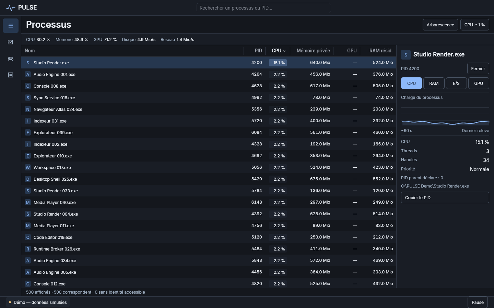

# PULSE · Moniteur système Windows

Préversion Windows 11 x64, écrite en Rust avec [Rune](https://github.com/anomalyco/rune). **PULSE.exe démarre sur le tableau Processus avec les mesures réelles, sans console.** La recherche en haut filtre immédiatement le tableau ; depuis un autre écran, validez avec **Entrée**.



## Lancer

Installer Git, [rustup](https://rustup.rs/) et les outils de compilation **Desktop development with C++** de Visual Studio avec un SDK Windows. Le projet épingle Rust 1.99.1 et les dépendances Cargo. Rune utilise un adaptateur graphique Windows compatible wgpu/D3D12 ; en cas d’échec, consulter le message de démarrage.

```powershell
cargo run --locked                       # mesures de ce PC; sans élévation
cargo run --locked -- --record .\incident.sqlite --retain 3600
cargo run --locked -- --replay .\incident.sqlite
cargo build --locked --release -p pulse-app
```

Avec le paquet portable, double-cliquer sur l’exécutable. L’enregistrement est optionnel : choisir un **nouveau fichier** situé dans un répertoire personnel et passer `--record`. La fermeture arrête la session. `--retain` limite le nombre de points conservés (1 à 86 400). La relecture ouvre en lecture seule les 900 derniers points. La pause fige l’affichage ; l’enregistrement explicitement demandé continue.

**GPU** mesure les adaptateurs NVIDIA avec NVML si le pilote le permet : activité, VRAM, température, fréquence, puissance, consigne du ventilateur et moteurs vidéo. L’activité du premier adaptateur est utilisée dans la vue d’ensemble ; elle ne représente pas la somme des GPU. Il n’y a ni démonstration ni simulation dans l’exécutable distribué. Les captures de développement utilisent des fixtures identifiées.

**GPU → Par processus** trie les mesures Windows WDDM par activité ou par VRAM dédiée. Le tableau **Processus** affiche le maximum mesuré par moteur ; l’inspecteur donne le détail par adaptateur. Une valeur absente n’est pas un zéro. Ces mesures sont indépendantes de NVIDIA NVML et ne sont pas enregistrées dans les sessions.

**Moniteur** rassemble CPU, RAM utilisée et totale, GPU et VRAM, débits et latences disque, réception et émission réseau, temps depuis le démarrage de Windows et durée d’observation. Il s’ouvre aussi depuis **Processus → Moniteur**. Température, fréquence, puissance, ventilateur et VRAM de la carte sont affichés quand NVIDIA NVML les fournit. Pour la température CPU, ouvrez les capteurs dans HWiNFO et activez **Shared Memory Support** dans ses réglages ; PULSE lit la sonde récente dans **Moniteur** et **Détail CPU**, sans installer ni lancer de pilote. Cela ne lit pas NZXT CAM. Les sessions SQLite restent limitées aux mesures agrégées existantes.

### FPS et frametimes (PresentMon)

1. Le paquet Windows intègre le [CLI officiel PresentMon 2.3.1 x64](https://github.com/GameTechDev/PresentMon/releases/tag/v2.3.1). Il est préparé dans un dossier temporaire à la demande : pas d’installation de service, de téléchargement au lancement ni de configuration manuelle. Un build `cargo run` standard n’intègre pas le CLI ; un chemin peut y être choisi manuellement.
2. Dans **Jeux**, sélectionnez 15, 30 ou 60 secondes et cliquez sur **Capturer en auto**. Revenez directement dans le jeu dans les 45 secondes. PULSE choisit la première application admissible qui reste au premier plan ; ce n’est pas une reconnaissance du titre du jeu. Les périodes où le processus ciblé n’est plus au premier plan sont exclues, sans prolonger la capture. Pour forcer une cible, passez par **Processus → Mesurer les FPS… → Capturer la cible**.
3. Une capture en direct nécessite les droits ETW de Windows. Si l’accès est refusé, vérifiez les droits du compte (notamment le groupe **Utilisateurs des journaux de performances**) ou utilisez **Jeux → Autres options → Importer un CSV…**. PULSE ne s’élève pas.

PULSE affiche les FPS à l’écran lorsque PresentMon fournit `DisplayedTime` ; les cadences de présentation ou d’application sont signalées séparément en l’absence de mesure d’affichage. Le rapport reste en mémoire, hors des sessions SQLite ; les fichiers temporaires de capture sont supprimés à la fin du traitement.

Dans **Processus**, cliquez sur un en-tête pour trier et sélectionnez une ligne pour ouvrir l’inspecteur. Les courbes CPU, mémoire privée et GPU couvrent jusqu’à la dernière minute depuis la sélection de cette instance ; aucun historique n’est reconstruit. **RAM → Ouvrir le suivi mémoire → Suivre la sélection** démarre le suivi long. Un signal « Fuite potentielle » n’est pas une confirmation.

**Stockage et réseau** affiche les débits agrégés en direct et à la relecture des nouvelles sessions SQLite. Les anciennes sessions restent lisibles, mais ne contiennent pas ces débits. Le périmètre réseau est limité aux interfaces matérielles Ethernet et Wi-Fi actives.
**Performances → Détail CPU** affiche la charge par processeur logique et la fréquence remontée par Windows lorsqu’elle est disponible. **Processus** utilise les icônes des exécutables locaux, avec une initiale de remplacement si Windows ne fournit pas la ressource.

- **Processus → Arborescence** : déplier ou replier les branches. Un parent doit avoir été créé avant l’enfant. En recherche ou avec un filtre, seuls les résultats correspondants sont affichés.
- **Sessions → Copier le CSV** : copie la période visible, sans nom de machine, nom de processus, chemin ni adresse réseau. Pour exporter toute la rétention d’une session vers un nouveau fichier : `.\PULSE.exe --replay .\incident.sqlite --export-csv .\incident.csv`.
- **Sessions → Sessions locales** : **Enregistrer…** crée une session (3 600 points conservés depuis l’interface), **Arrêter** clôt le fichier et **Ouvrir une session…** passe en lecture seule. **Revenir au direct** reprend la collecte. Le sélecteur Windows n’écrit rien tant que le chemin n’a pas été confirmé ; un fichier déjà présent n’est jamais écrasé.
- **Sessions → Processus à cet instant** : cliquer ou glisser sur la courbe pour afficher les six premiers processus en CPU ou mémoire privée à cet instant. Le direct garde ce détail en RAM. Pour le conserver en relecture, activer **Inclure les processus** avant l’enregistrement ; les noms et PID restent dans le fichier local et n’apparaissent jamais dans le CSV. En CLI : `--record session.sqlite --with-processes`.
- **Stockage → Latence** : moyennes agrégées de lecture et d’écriture des disques physiques. En l’absence d’opérations sur l’intervalle, la latence reste indisponible.
- **Moniteur → Disque et réseau → Stockage** : inventaire des disques Windows, volumes avec lettres et espace libre, activité, lecture/écriture et latence par disque. Cliquez sur un disque pour afficher jusqu’à 60 secondes de débit. Santé, température, endurance, heures et total écrit apparaissent uniquement quand le matériel et Windows les fournissent (les données détaillées ne sont pas enregistrées en session).
- **Stockage et réseau → Connexions** : inventaire TCP et ports UDP, en IPv4 et IPv6. Filtrer par protocole, PID ou port. La liste n’est collectée que pendant l’inspection locale, sans résolution DNS ni enregistrement des adresses.
- **Processus → E/S** : débits de lecture et d’écriture calculés à partir des compteurs cumulés Windows, pour la même instance de processus. Les opérations sur fichiers, réseau et périphériques sont agrégées.
- **Processus → Modifier la priorité…** : choisir Très basse, Basse, Normale ou Au-dessus de la normale, puis confirmer. PULSE ne propose ni Haute ni Temps réel et n’élève pas ses droits.
- **Sessions → Afficher le diagnostic CPU** : la règle `CPU-01` signale une charge d’au moins 90 % pendant 15 s sur des mesures contiguës. Elle s’évalue en direct ou au point sélectionné de l’historique, sans attribuer automatiquement la cause.
- Avec plusieurs écrans, PULSE demande une ouverture inactive sur un écran non principal ; avec un seul écran, le lancement est normal.

## Vérifier et contribuer

```powershell
cargo fmt --all -- --check
cargo clippy --locked --workspace --all-targets -- -D warnings
cargo test --locked --workspace
cargo build --locked -p pulse-app
.\scripts\capture.ps1
```

- [Architecture et arbitrages](docs/ADR-0001-architecture.md)
- [Design system implémenté](docs/DESIGN-SYSTEM.md)
- [Dépendances et audit Rune](docs/DEPENDENCIES.md)
- [Périmètre livré, limites et backlog](docs/IMPLEMENTATION-PLAN.md)
- [Résultats de validation Windows et première mesure d’empreinte](docs/VALIDATION.md)
- [Spécification d’origine consolidée](PULSE-ADR-DESIGN-SYSTEM-complet.md)

Licence [MIT](LICENSE). Les fonctions de PULSE ne requièrent ni compte ni connexion réseau ; la compilation récupère les dépendances publiées.
