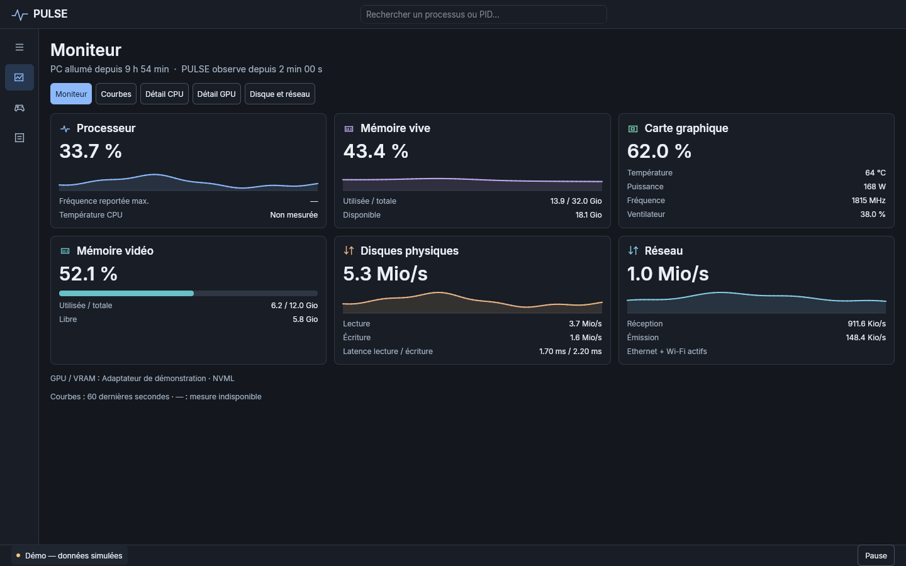
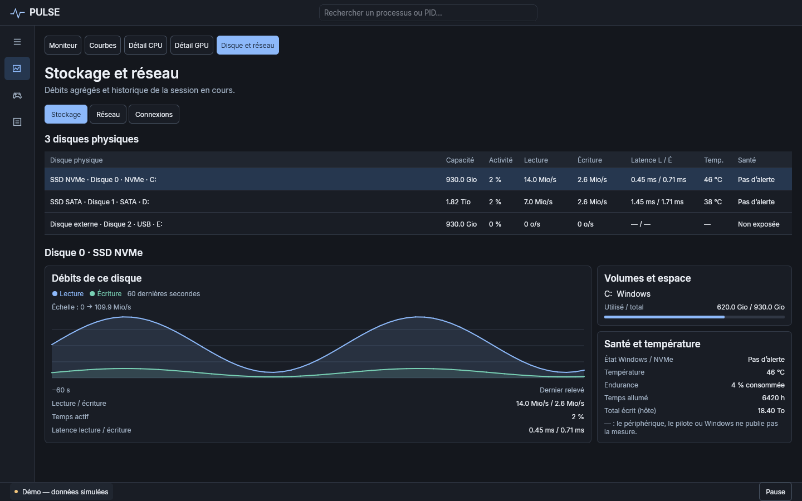
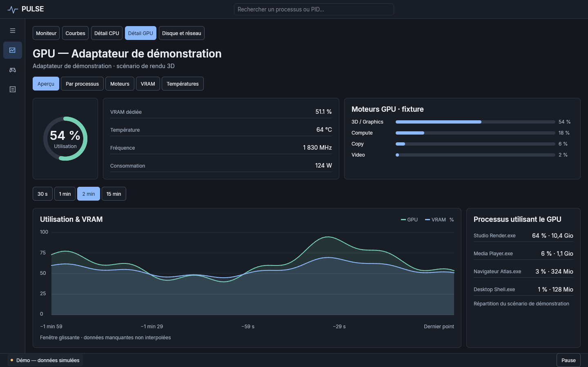
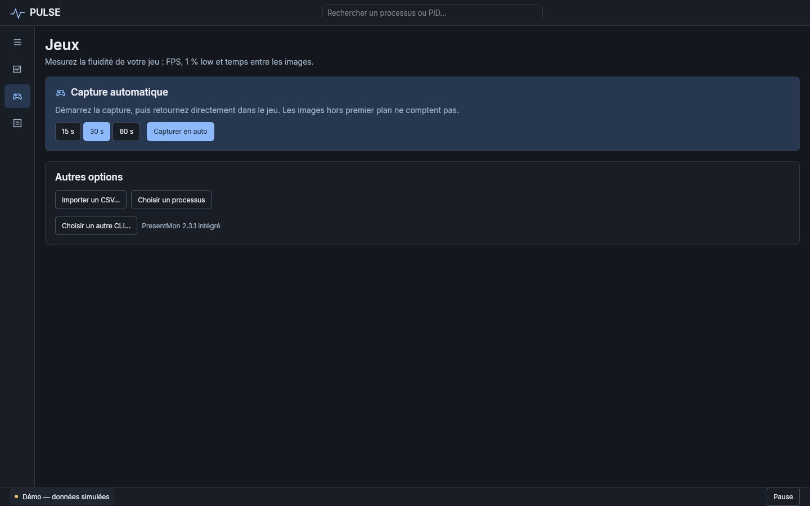
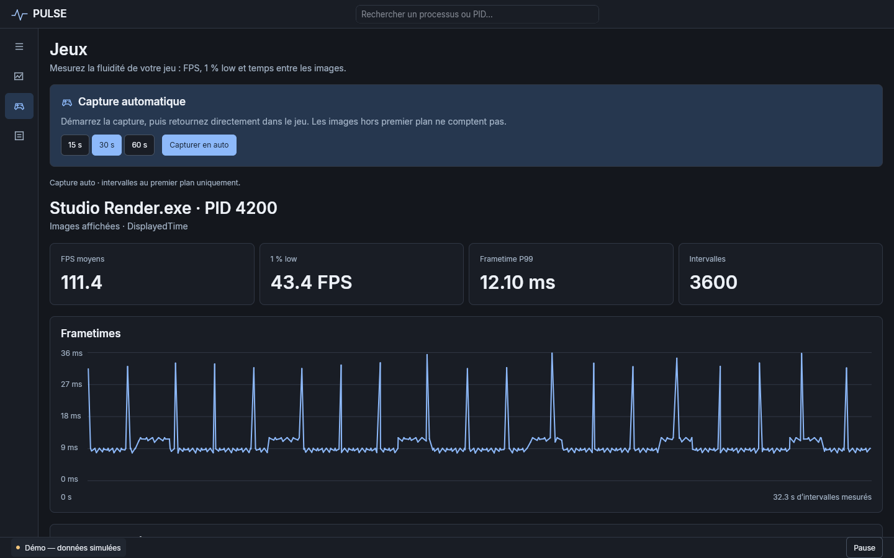
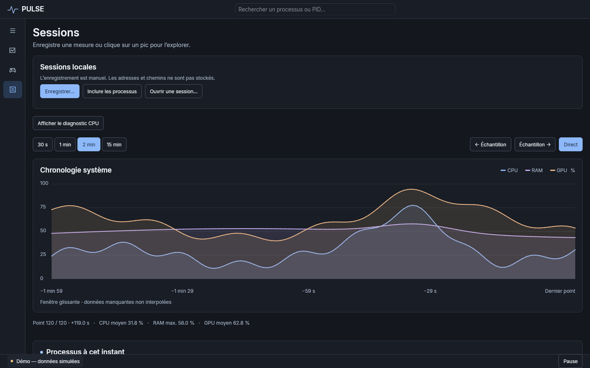
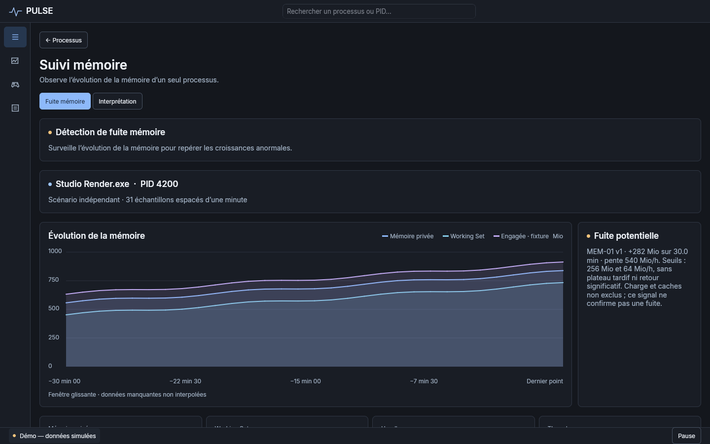
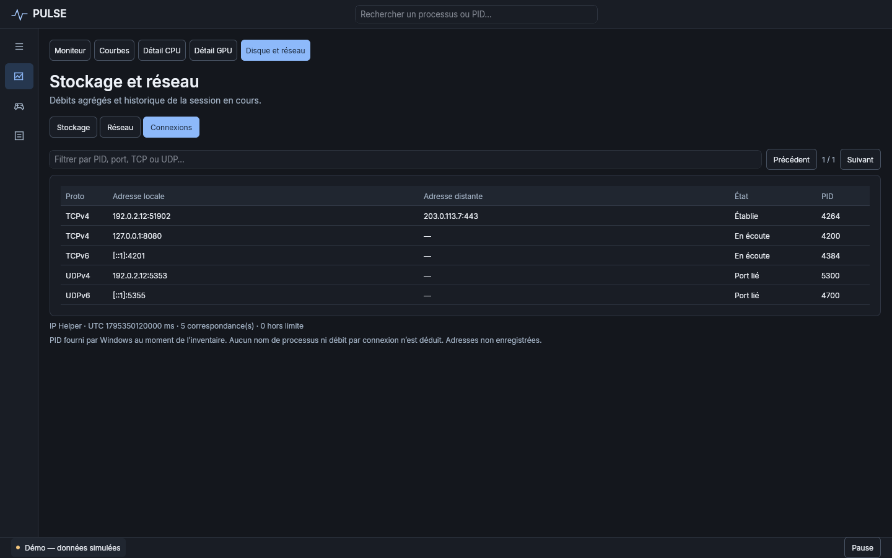

# PULSE

**A native task manager and system monitor for Windows 11 x64.** Built in Rust with [Rune](https://github.com/anomalyco/rune).

PULSE opens directly to the live process table, without a console. Sort or filter processes, select one to inspect its CPU, memory, I/O and GPU activity, or switch to the system monitor for a quick look at the whole PC.


> The screenshots use simulated data. The portable executable starts with real measurements.

**Interface language:** Use **Language / Langue** in the top bar to switch between **System**, **Français**, and **English** without restarting. System mode follows the Windows display language (English for unsupported languages). Your choice is saved locally; process and device names are left unchanged.

## Screenshots

### System monitor

CPU and GPU load, RAM and VRAM usage, disk and network throughput, and uptime on one screen.



### Storage

Select a physical drive to see its activity, read/write rates, latency, volume space, and available health data.



### GPU and game performance

| GPU inspector | PresentMon capture |
| --- | --- |
| [](assets/captures/pulse-gpu.png) | [](assets/captures/pulse-gaming.png) |



### Sessions and diagnostics

| System timeline and local sessions | Process memory tracking |
| --- | --- |
| [](assets/captures/pulse-history.png) | [](assets/captures/pulse-memory.png) |

### Network connections



[System diagnostics](assets/captures/pulse-diagnostics.png) · [Resource charts](assets/captures/pulse-overview.png) · [Compact process table at 150% scale](assets/captures/pulse-processes-compact-150.png)

## Run PULSE

**If you have the portable ZIP**, extract it and run `PULSE.exe`. You do not need Rust or a separate PresentMon installation. With multiple monitors, PULSE requests an inactive window on a non-primary display.

**To build from source**, install Git, [rustup](https://rustup.rs/), and the Visual Studio **Desktop development with C++** build tools with a Windows SDK. The project pins Rust and its dependencies. The interface requires a graphics adapter supported by Rune's wgpu/D3D12 backend.

```powershell
cargo run --locked                        # Live monitoring, without elevation
.\scripts\package-windows.ps1 -NoSmoke     # Package the portable Windows x64 ZIP
```

The packaging script verifies and embeds the official [PresentMon 2.3.1 x64 CLI](https://github.com/GameTechDev/PresentMon/releases/tag/v2.3.1). It writes `artifacts/PULSE-windows-x64.zip`. A normal `cargo run` development build does not bundle the CLI; you can select it manually in **Jeux**.

## What you can do

- **Processes:** Search by name or PID, sort columns, switch to a verified parent/child tree, and inspect up to a minute of CPU, private memory and GPU readings after selecting a process. Termination and priority changes require confirmation. PULSE does not offer high or real-time priority and does not elevate itself.
- **Hardware:** See logical CPU activity and Windows-reported frequencies. NVIDIA NVML provides adapter readings where supported; Windows WDDM provides per-process GPU engine activity and video memory independently of NVML. GPU activity is the busiest measured engine, not the sum of all engines. For CPU temperature, enable **Shared Memory Support** and keep sensors active in HWiNFO; PULSE reads the shared sensor data, not NZXT CAM.
- **Storage and network:** Inspect physical drives, volume space, per-drive throughput and latency, and supported SMART/NVMe readings. Inspect local TCP/UDP endpoints on demand, without DNS lookups or storing addresses. Unsupported or unreported readings are shown as unavailable, not zero.
- **Gaming:** In **Gaming**, choose 15, 30 or 60 seconds and click **Start auto capture**, then return to the game within 45 seconds. Capture targets the eligible foreground process; time spent out of focus is excluded without extending the capture. Reports include displayed FPS when PresentMon can measure it, a 1% low, P99 and a frametime chart. Presentation or application cadence is labeled separately. Live capture depends on Windows ETW permissions; importing a PresentMon CSV is an alternative. Reports remain in memory.
- **Sessions:** Record or reopen SQLite sessions, inspect historical spikes and their top CPU/memory contributors, and export aggregate CSV. Recording contributors is optional; names and PIDs are not included in CSV. Memory growth is a reason to investigate, not proof of a leak. The sustained CPU diagnostic does not assign a cause to a process.

## Sessions from the command line

```powershell
.\PULSE.exe --record .\incident.sqlite --retain 3600
.\PULSE.exe --record .\incident-with-processes.sqlite --with-processes
.\PULSE.exe --replay .\incident.sqlite
.\PULSE.exe --replay .\incident.sqlite --export-csv .\incident.csv
```

Recording only creates new files. `--retain` accepts 1 to 86,400 samples. Replay opens read-only and shows up to the latest 900 samples; CSV export to a new file includes the full retained session. Pausing the display does not stop an explicitly started recording. Detailed GPU readings, storage inventories and game reports are not saved in SQLite.

## Development

```powershell
cargo fmt --all -- --check
cargo clippy --locked --workspace --all-targets -- -D warnings
cargo test --locked --workspace
cargo build --locked -p pulse-app
.\scripts\capture.ps1                      # Regenerate the screenshots off-screen
```

[Architecture](docs/ADR-0001-architecture.md) · [Design system](docs/DESIGN-SYSTEM.md) · [Dependencies](docs/DEPENDENCIES.md) · [Roadmap](docs/IMPLEMENTATION-PLAN.md) · [Windows validation](docs/VALIDATION.md)

PULSE is [MIT licensed](LICENSE). The bundled CLI has its own [PresentMon license](third-party/PresentMon-LICENSE.txt). Monitoring is local and requires no account or network connection.
